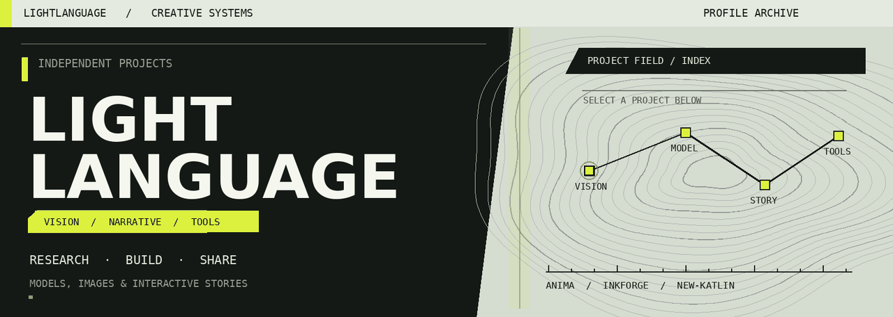

  

  <strong>VISUAL　/　LANGUAGE　/　INTERACTION</strong> 
  探索生成模型、视觉创作与交互叙事，记录实验与构建过程。

  <a href="https://github.com/lightlanguage1?tab=repositories">全部项目</a>　/　
  <a href="https://huggingface.co/lightlanguang/Anima-Single-LoRA-Style-Transfer-10788">Hugging Face 模型</a>　/　
  <a href="https://lightlanguage1.github.io/anima-single-lora-style-transfer/">Anima 研究展示</a>

---

## PROJECT INDEX / 项目档案

选择档案展开，查看项目介绍与入口。

<strong>01　/　ANIMA STYLE TRANSFER</strong>　—　视觉研究 · 画风迁移

 

探索参考图引导的画风迁移与内容保持，记录训练过程、交叉测试、已有局限，并提供 ComfyUI 节点与工作流。

**研究路径**　参考图 → 单 LoRA → 输出 → 交叉评估  
**工具**　`PyTorch`　`LoRA`　`ComfyUI`

[项目代码](https://github.com/lightlanguage1/anima-single-lora-style-transfer)　/　[研究展示](https://lightlanguage1.github.io/anima-single-lora-style-transfer/)　/　[10788 LoRA](https://huggingface.co/lightlanguang/Anima-Single-LoRA-Style-Transfer-10788)

<strong>02　/　INKFORGE</strong>　—　语言系统 · AI 叙事

 

面向中文长篇小说的 AI 创作系统，探索 Agent、叙事规划与故事记忆。

**创作路径**　设定 → 规划 → 写作 → 故事记忆  
**工具**　`Python`　`Agents`　`React`

[查看 InkForge](https://github.com/lightlanguage1/InkForge)

<strong>03　/　NEW-KATLIN</strong>　—　游戏系统 · 交互设计

 

游戏开发学习项目，探索角色成长、战斗与经营机制。

**探索方向**　角色 / 战斗 / 经营 / 故事  
**工具**　`Unity`　`C#`

[查看 New-Katlin](https://github.com/lightlanguage1/New-Katlin)

---

### TOOLBOX / 工作台

`Python` · `PyTorch` · `ComfyUI` · `LoRA` · `React` · `TypeScript` · `Unity` · `C#`

持续实验，记录结果，也分享尚未解决的问题。
