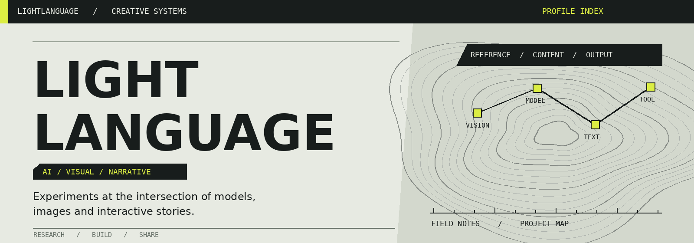

  

### 欢迎来到我的研究与创作记录

我在探索 **生成式 AI、视觉创作和交互叙事**：从模型实验到工具落地，把过程、结果和遇到的问题一起记录下来。

Exploring generative models, creative tools, and interactive systems.

**领域**　视觉生成 / 语言模型 / 游戏与叙事　　**工作方式**　实验 · 构建 · 分享

---

## 项目档案 / Project index

参考图引导的画风迁移研究，包含训练实验、评估记录和 ComfyUI 节点。  
[项目代码](https://github.com/lightlanguage1/anima-single-lora-style-transfer)　/　[研究展示](https://lightlanguage1.github.io/anima-single-lora-style-transfer/)　/　[10788 LoRA](https://huggingface.co/lightlanguang/Anima-Single-LoRA-Style-Transfer-10788)

面向中文长篇小说的 AI 创作系统，探索 Agent、叙事规划和故事记忆。  
[查看 InkForge](https://github.com/lightlanguage1/InkForge)

游戏开发学习项目，探索角色成长、战斗与经营机制。  
[查看 New-Katlin](https://github.com/lightlanguage1/New-Katlin)

---

## 工作台 / Toolbox

**模型与生成**　`Python` · `PyTorch` · `LoRA` · `ComfyUI`  
**应用与交互**　`React` · `TypeScript` · `Unity` · `C#`

> 保持好奇，记录实验，让想法逐渐变成可以使用的作品。

[全部公开项目](https://github.com/lightlanguage1?tab=repositories)　/　[Hugging Face 模型](https://huggingface.co/lightlanguang/Anima-Single-LoRA-Style-Transfer-10788)
