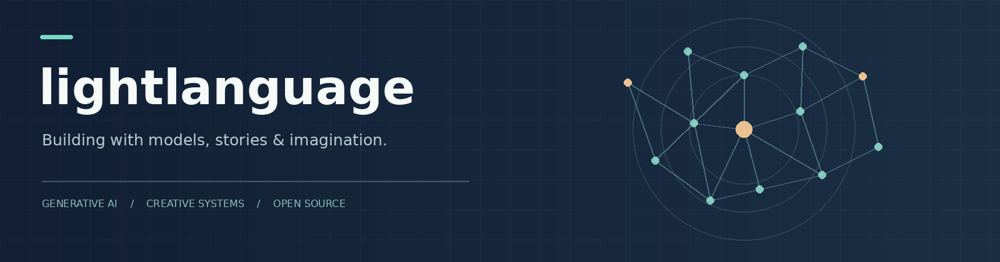

  

<h1 align="center">你好，我是 lightlanguage 👋</h1>

  探索生成式 AI、视觉创作与交互叙事，把想法做成可以运行的作品。 
  Exploring generative AI, visual creation and interactive storytelling.

  <a href="https://lightlanguage1.github.io/anima-single-lora-style-transfer/">研究展示</a> &nbsp;·&nbsp;
  <a href="https://huggingface.co/lightlanguang/Anima-Single-LoRA-Style-Transfer-10788">Hugging Face 模型</a> &nbsp;·&nbsp;
  <a href="https://github.com/lightlanguage1?tab=repositories">全部项目</a>

---

### 🔭 正在探索 | What I'm exploring

- **画风迁移与生成模型**：围绕 Anima、LoRA 和 ComfyUI，探索参考图画风与内容保持。
- **AI 与故事创作**：尝试用语言模型、记忆和工作流构建更有连续性的创作工具。
- **交互与游戏系统**：对角色、叙事和可扩展的游戏机制保持好奇。

### ✨ 精选项目 | Selected projects

| 项目 | 简介 |
| :-- | :-- |
| [**Anima Single-LoRA Style Transfer**](https://github.com/lightlanguage1/anima-single-lora-style-transfer) | 参考图引导的画风迁移研究，包含实验记录、ComfyUI 节点与工作流。 [研究页面](https://lightlanguage1.github.io/anima-single-lora-style-transfer/) · [10788 LoRA](https://huggingface.co/lightlanguang/Anima-Single-LoRA-Style-Transfer-10788) |
| [**InkForge**](https://github.com/lightlanguage1/InkForge) | 面向中文长篇小说的 AI 创作系统，探索 Agent、叙事规划与故事记忆。 |
| [**New-Katlin**](https://github.com/lightlanguage1/New-Katlin) | 游戏开发学习项目，探索角色成长、战斗与经营机制。 |

### 🛠️ 常用技术 | Toolbox

`Python` · `PyTorch` · `ComfyUI` · `LoRA` · `React` · `TypeScript` · `Unity` · `C#`

---

持续实验，记录结果，也分享还没有解决的问题。

