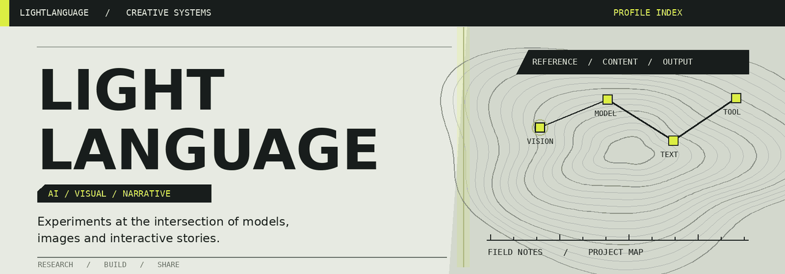

  

  <strong>模型 × 图像 × 故事</strong> 
  从实验出发，把想法做成可以运行的作品。

  <a href="https://lightlanguage1.github.io/lightlanguage1/"><strong>▶ 打开交互式项目终端</strong></a>　/　
  <a href="https://github.com/lightlanguage1?tab=repositories">全部项目</a>　/　
  <a href="https://huggingface.co/lightlanguang/Anima-Single-LoRA-Style-Transfer-10788">Hugging Face</a>

---

## 项目档案 / PROJECT INDEX

点击档案标题展开，查看每个项目的介绍和入口。

<strong>01　ANIMA / 画风迁移研究</strong>　·　VISUAL / RESEARCH

 

研究参考图引导的画风迁移与内容保持，整理了训练过程、交叉测试、已有局限和 ComfyUI 节点。

`PyTorch`　`LoRA`　`ComfyUI`

[项目代码](https://github.com/lightlanguage1/anima-single-lora-style-transfer)　/　[研究展示](https://lightlanguage1.github.io/anima-single-lora-style-transfer/)　/　[10788 LoRA](https://huggingface.co/lightlanguang/Anima-Single-LoRA-Style-Transfer-10788)

<strong>02　INKFORGE / AI 故事创作</strong>　·　LANGUAGE / TOOLS

 

面向中文长篇小说的 AI 创作系统，探索 Agent、叙事规划与故事记忆。

`Python`　`Agents`　`React`

[查看 InkForge](https://github.com/lightlanguage1/InkForge)

<strong>03　NEW-KATLIN / 游戏系统</strong>　·　GAME / INTERACTION

 

游戏开发学习项目，探索角色成长、战斗与经营机制。

`Unity`　`C#`　`Interaction`

[查看 New-Katlin](https://github.com/lightlanguage1/New-Katlin)

---

### 工作台 / TOOLBOX

`Python` · `PyTorch` · `ComfyUI` · `LoRA` · `React` · `TypeScript` · `Unity` · `C#`

持续实验，记录结果，也分享尚未解决的问题。
